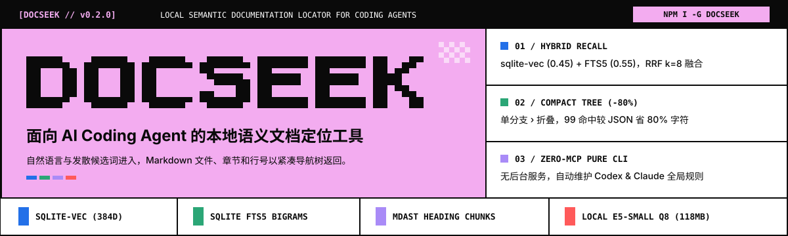
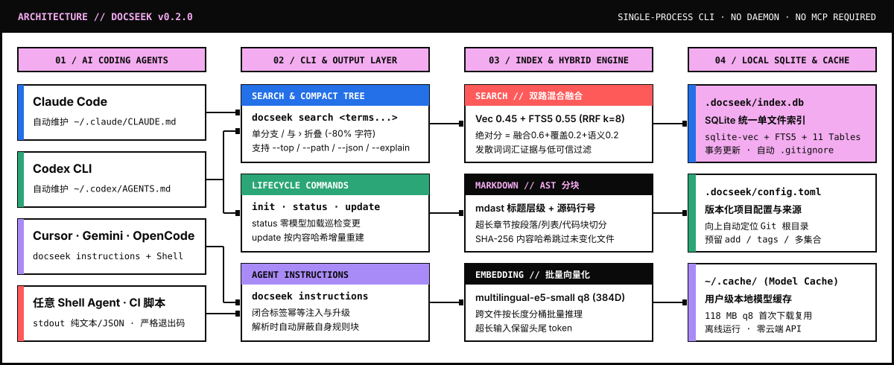
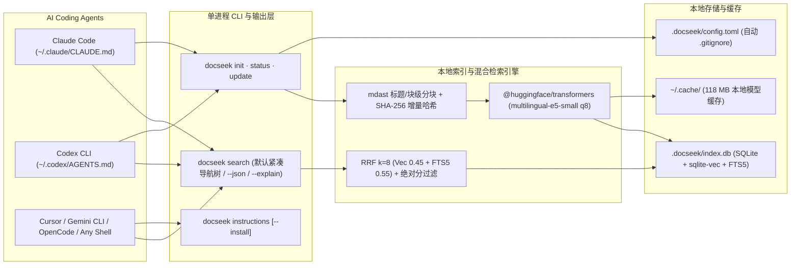

<div align="center">

<a href="https://github.com/evepupil/DocSeek">
  
</a>

<br />

 &nbsp; **DocSeek** — 面向 AI Coding Agent 的本地语义文档定位工具 · Semantic Documentation Locator

[](https://nodejs.org/)
[](tsconfig.json)
[](#架构与原理)
[](package.json)
[](#核心特性)
[](LICENSE)

> **Retrieval is navigation, not context generation.**
> 自然语言与发散候选词进入，Markdown 文件、章节和行号以紧凑导航树返回。

[快速开始](#快速开始) · [核心特性](#核心特性) · [真实输出](#真实输出与上下文压缩) · [架构与原理](#架构与原理) · [命令手册](#命令与选项参考) · [混合检索评测](#混合检索与质量评测) · [Web 展示站](#仓库结构与开发验证)

</div>

---

## 为什么需要 DocSeek？

当项目积累了数十甚至上百份架构设计、模块规格与验收文档，AI Coding Agent 往往**知道自己要找什么概念，却不知道文档原文究竟用了哪个词**：

- **字面检索易漏检**：`grep` / `rg` 要求 Agent 先猜中原文用词，面对同义改写、中英文混写或历史术语容易反复空手而归。
- **常规 RAG 过度挤占上下文**：固定长度切块容易破坏章节标题语义，且直接向 Agent 灌入大段检索正文与冗长 JSON 路径，稀释推理注意力。
- **过重基础设施负担**：引入常驻向量服务、容器或复杂 MCP 桥接，既增加本地环境维护成本，又限制了不同 Agent 工具的通用性。

**DocSeek 的解法**：把 **本地多语言 Embedding（`sqlite-vec`）+ SQLite FTS5 关键词召回 + Markdown AST 标题分块 + 紧凑导航树** 封装进一个 **无后台进程、纯本地单进程 CLI**。默认只返回文件、章节和精确源码行号，正文继续留在项目文档中，由 Agent 按需精准读取并自行判断。

---

## 核心特性

- **双路加权混合检索（`sqlite-vec` 0.45 + `FTS5` 0.55）**
  - 默认本地模型为 `Xenova/multilingual-e5-small` q8（约 118 MB，384 维），首次使用自动缓存到用户目录，之后全程离线本地执行。
  - SQLite FTS5 增加中文连续双字（bigrams）并赋予标题更高 BM25 权重，保底项目黑话、缩写和代码标识符精确命中。
  - 采用 RRF 常数 `k = 8` 与 `0–1` 绝对检索分（排名融合 `0.60` + 词项覆盖 `0.20` + 语义强度 `0.20`），低可信噪声自动过滤，明确无答案时返回空结果。

- **紧凑导航树输出（相较 JSON 减少约 80% 字符与 88% 行数）**
  - 自动提取共同目录前缀，将单分支连续目录、文件和标题用 `/` 与 `›` 折叠至同一行；分叉节点自底向上汇总 `×命中数 .平均分`，按分支内部最高分优先排序。
  - 在 InferForge 实测返回 99 个位置的查询中，紧凑树仅占 **4,374 字符 / 125 行**，同一批结果的 JSON 占 **21,582 字符 / 1,048 行**。

- **Markdown AST 标题感知分块与精确行号**
  - 基于 `mdast` 解析标题层级与块级结构，超长章节沿段落、列表和代码块边界二次切分，不截断上下文并保留准确的 `L起-止` 源码行号。
  - 索引阶段自动屏蔽 DocSeek 自身注入的规则区块（保留换行），防止搜索自匹配同时保持后续行号准确。

- **内容哈希增量更新 + 零模型加载巡检**
  - `docseek status` 仅比对文件内容哈希与数据库记录，**不加载 Embedding 模型**，适合 Agent 在每次检索前低成本检查待处理变化。
  - `docseek update` 仅对新增与修改文档执行解析和跨文件按长度分桶批量向量化，未变化文件跳过，纯删除更新不加载模型。

- **零侵入单进程 CLI · 自动接入主流 Coding Agent**
  - 无常驻守护进程、无外部数据库服务、无容器、不强制 MCP，任何能执行 shell 命令的 Agent 都能直接使用。
  - `npm install --global docseek` 自动维护 `~/.codex/AGENTS.md` 与 `~/.claude/CLAUDE.md` 中的闭合标签规则块（`<!-- DOCSEEK:INSTRUCTIONS:START/END -->`），原位升级且不触碰用户原有规则。

- **清晰的可扩展存储边界**
  - 项目数据完全保存在 `.docseek/`（`config.toml` + `index.db`）并自动写入 `.gitignore`。
  - 数据库已按 `Collection → Source → Document → Chunk → Embedding` 及独立 `tags` 关联表设计，为后续 `add`、`--tag` 与跨项目集合预留平滑演进边界。

---

## 架构与原理



<details>
<summary>查看 Mermaid 文本版架构图</summary>



</details>

### 本地存储结构

`docseek init` 会从当前工作目录向上自动定位 `.docseek/config.toml` 或 Git 项目根目录，创建隔离目录并将 `/.docseek/` 自动写入 `.gitignore`：

```text
.docseek/
├─ config.toml   # 版本化项目配置、来源定义与模型指纹
└─ index.db      # SQLite 统一索引（11 张表：documents / chunks / chunk_embeddings / chunks_fts / tags）
```

---

## 真实输出与上下文压缩

下面来自 InferForge 真实项目索引（126 份 Markdown、1,598 个可检索章节）：

```console
$ docseek search "容量判断" "Worker启动时间" "SLA可行性" --top 8
inferforge-docs/
├─ 模块设计/ ×7 .803
│  ├─ M2-弹性容量调配.md ×5 .805
│  │  ├─ 3. 本期容量判断 › 3.1 触发条件 L105-117 .844
│  │  ├─ 2. 容量动作 ×3 .797
│  │  │  ├─ 2.3 启动新 Worker L92-101 .831
│  │  │  ├─ 2.1 统一就绪时间 L64-74 .789
│  │  │  └─ 2.2 调配现有 Worker L76-90 .772
│  │  └─ 7. 当前实现 L258-291 .788
│  ├─ M2-SLA队列与派活.md › 7. 当前实现 L256-273 .830
│  └─ M2-调度策略层.md › 8. 当前实现 L209-220 .765
└─ 需求规格.md › 13. 分期验收标准 › 13.3 M2 验收标准 L540-553 .794
```

| 符号表达        | 含义                                                   |
| --------------- | ------------------------------------------------------ |
| `×7 .803`       | 该分支包含 7 个命中位置，平均绝对分为 `.803`           |
| `›`             | 只有一个子节点的连续文件与标题层级已折叠到同一行       |
| `L105-117 .844` | 原文位于第 105 至 117 行，该位置绝对检索强度为 `.844`  |
| 分支排序        | 按内部**最高分**优先排列，确保最值得读取的位置最先出现 |

| 99 个命中的同一次查询对比 | 字符数    | 行数    | 相对 JSON 节省      |
| ------------------------- | --------- | ------- | ------------------- |
| JSON (`--json`)           | 21,582    | 1,048   | 基准                |
| 未折叠树形                | 6,778     | 242     | -68.6% / -76.9%     |
| **默认紧凑导航树**        | **4,374** | **125** | **-79.7% / -88.1%** |

---

## 快速开始

要求 **Node.js >= 22**。

### 1. 安装

#### 方式一：npm 全局安装（推荐）

```bash
npm install --global docseek
```

全局安装会自动把精简检索规范写入以下两个用户级 Agent 规则文件（存在闭合标签时原位替换，不存在时追加，绝不改写原有规则）：

```text
~/.codex/AGENTS.md
~/.claude/CLAUDE.md
```

如果 npm 禁用了安装脚本或需要手工修复，执行：

```bash
docseek instructions --install
```

查看标准规范提示词（可直接粘贴给 Cursor、Gemini CLI、OpenCode 等其他 Agent）：

```bash
docseek instructions
```

#### 方式二：从源码构建并本地链接

```bash
git clone https://github.com/evepupil/DocSeek.git
cd DocSeek
npm install
npm run build
npm link
```

### 2. 初始化索引并搜索

在目标项目根目录或任意子目录下执行：

```bash
cd /path/to/your-project
docseek init
```

推荐像使用 `grep` / `rg` 一样传入 **2–5 个发散候选词**（同义词、缩写、中英文翻译与项目黑话），完整问题留给 Agent 读取原文后再判断：

```bash
docseek search "容量判断" "Worker启动时间" "SLA可行性"
docseek search "SLA" "违约" "退款" "赔付"
docseek search "worker" "掉线" "preemption" "retry"
docseek search "scheduler" "GPU" "cold start" "warm pool"
```

找到相关目录或文件后，再通过 `--path` 或 `--top` 收窄：

```bash
docseek search "调度策略" --path docs/模块设计/
docseek search "调度策略" --top 5
```

---

## 命令与选项参考

### 子命令一览

| 命令                               | 作用                                                     |
| ---------------------------------- | -------------------------------------------------------- |
| `docseek init`                     | 创建或完整重建当前项目索引（自动配置 `.gitignore`）      |
| `docseek status [--json]`          | 不加载模型，低成本查看索引规模、更新时间与待处理文件变更 |
| `docseek update`                   | 按文件内容哈希仅处理新增、修改和删除的 Markdown          |
| `docseek search <query...>`        | 混合检索并返回文件、标题层级、源码行区间与绝对分数       |
| `docseek instructions [--install]` | 输出或幂等安装 Codex / Claude 用户级 Agent 规则区块      |

### `search` 选项

| 选项             | 作用                                                         |
| ---------------- | ------------------------------------------------------------ |
| `--top <1..100>` | 最多返回的位置数量；不传时返回召回池内全部通过门槛的可信结果 |
| `--path <路径>`  | 仅检索路径中包含指定子串的文档（路径统一使用 `/`）           |
| `--json`         | 输出稳定的机器可读 JSON 到 `stdout`                          |
| `--snippet`      | 附带短正文片段预览，适合人工核对与调试                       |
| `--explain`      | 显示查询模式、向量/关键词信号、放行原因及各阶段耗时          |

### Agent 日常使用闭环

```text
文档可能发生变化
  -> docseek status          # 不加载模型，快速确认是否有待处理变化
  -> docseek update          # 仅在有变化时按哈希增量同步
  -> docseek search ...      # 发散候选词获取紧凑导航树
  -> Read L起-止             # Agent 按行号读取 Markdown 原文并判断
```

---

## 混合检索与质量评测

- **融合权重**：向量路 `0.45` + FTS5 关键词路 `0.55`，RRF 常数 `k = 8`，拉开前列与后排差距。
- **绝对分数**：`0.60 × 排名融合 + 0.20 × 词项覆盖 + 0.20 × 语义强度`，范围 `0–1`，可跨查询横向比较。
- **模式自适应与防噪声**：保留 CLI 参数边界，自动区分发散候选词与完整问句；发散词放宽需项目内词汇证据（单术语 ≥ 1 / 多词包 ≥ 2），且 `--explain` 完整展示 `signal`、`dual-route`、`term-vector`、`term-keyword` 四种放行原因。
- **质量门禁表现**：
  - 自身 34 条真实模型质量门禁（`npm run eval:quality`）：正向 Top-5 命中率、精确术语第 1 名命中率、无答案识别率、重复排序稳定性均为 **100%**。
  - InferForge 冻结索引 90 条发散词实测：`Recall@5` 达 **0.356**，意图覆盖达 **0.767**，向量前 5 与关键词前 5 并集融合保留率 **0.889**。

---

## 边界与扩展方向

DocSeek 专注“**信息在哪里**”这一件事，刻意不承担：

- 自动总结、生成答案或向 Agent 注入大段检索正文
- 自动修改项目文档、后台文件监听常驻进程
- MCP 服务、云端托管服务、权限系统与多用户协作
- Code RAG、知识图谱与重型重排服务

沿现有内部数据边界规划的后续扩展（进度见 [Roadmap](docs/roadmap.md)）：

- `add` / `remove`：将项目外目录或单份文档纳入索引来源
- `--tag` 标签筛选：不改动正文与向量即可按来源或文档标签过滤
- 多项目全局集合：跨多个仓库统一检索工程记忆与设计规范
- 更多本地 Embedding 模型与可选重排器

---

## 仓库结构与开发验证

```text
DocSeek/
├── src/
│   ├── cli/            # Commander 命令、紧凑导航树与文本/JSON 输出
│   ├── application/    # init / update / status / search / 跨文件批量索引编排
│   ├── domain/         # Collection / Source / Document / Chunk / Tag 领域模型
│   ├── config/         # TOML 版本化配置读写
│   ├── project/        # Git 根目录探测与 .gitignore 维护
│   ├── sources/        # Markdown 目录发现与自身规则块屏蔽
│   ├── markdown/       # mdast 标题层级与块级切分
│   ├── embedding/      # 本地 multilingual-e5-small q8 向量化与分桶批处理
│   ├── storage/        # SQLite + sqlite-vec + FTS5 存储与迁移
│   ├── search/         # 中文双字词项、查询模式、RRF 融合与绝对分过滤
│   ├── instructions/   # Codex / Claude 闭合标签规则块生成与安装
│   └── evaluation/     # 离线检索质量评测引擎
├── eval/               # 真实模型检索质量问题集 (search-quality.json)
├── bench/embedding/    # 独立向量化模型性能评测
├── tests/              # unit/ 与 integration/ Vitest 测试套件
├── docs/               # 需求、技术、架构、模块设计与 SVG 图示资源
└── web/                # DocSeek 静态产品展示站与在线检索/压缩沙盒 (Vite)
```

### 运行 CLI 质量门禁与真实模型评测

```bash
npm install
npm run gate           # format:check + eslint + tsc + vitest + build + npm pack --dry-run
npm run eval:quality   # 使用真实本地 Embedding 模型跑全量检索质量评测
```

### 本地预览 Web 展示站与在线沙盒

`web/` 为独立静态站点工程，不影响 CLI 打包与发版：

```bash
cd web
npm install
npm run dev            # http://localhost:3000
```

---

## 延伸阅读

- [需求设计](docs/需求设计.md)
- [技术设计](docs/技术设计.md)
- [架构设计](docs/架构设计.md)
- [路线图 (Roadmap)](docs/roadmap.md)
- [紧凑树形输出模块设计](docs/模块设计/紧凑树形输出.md)
- [混合检索模块设计](docs/模块设计/混合检索.md)
- [Agent 使用入口模块设计](docs/模块设计/Agent使用入口.md)

## 参与贡献

欢迎通过 Issue 或 Pull Request 参与改进：

1. Fork 本仓库并创建特性分支（`git checkout -b feat/your-feature`）。
2. 提交变更前请补充对应单元测试，并确保 `npm run gate` 全部通过；涉及排序或索引逻辑调整时同步运行 `npm run eval:quality`。
3. 提交清晰的变更说明并发起 Pull Request。

## 开源协议

本项目基于 [MIT License](LICENSE) 开源。
